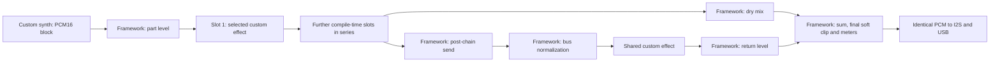

# Fixed FX slots and custom effects

`FxConfig.h` defines `SUGAR_FX_SLOTS` (default **2 serial insert slots per part**,
accepted range 1..8). It is compile-time storage, not a runtime allocation.
Override it in that header or through the shared build helper:

```powershell
./tools/build.ps1 -FxSlots 4 -BuildDirectory build-checks/four-slot
```

`eFxSlot` ends in `FX_SLOTS_COUNT`; bounds and iteration use that sentinel.
The existing shared send/return bus is retained after the serial insert chain.
All inserts start bypassed; sends and return start at zero.



## Registration and effect ownership

`InsertCatalog.h` registers `BypassEffect`, `DriveEffect`, `CrusherEffect` in
`InsertPool`. Their matching named algorithm enum is in `FxTypes.h` and ends in
`ALGORITHMS_COUNT`. Add a named algorithm and its concrete type to that list.
Update the count sentinel; compilation rejects enum/catalog count mismatches,
duplicate effect identities and invalid parameter descriptors. Keep built-in enum
entries aligned with their types because the compatibility API refers to them.

The shared bus chooses its concrete type through `SharedSendEffect` in
`EffectTypes.h`. Its parameters use the same local descriptor contract. A custom
send effect does not need the legacy global-parameter methods.

Each effect supplies:

```cpp
static constexpr const char* key();          // stable JSON identity, versioned semantics
static constexpr const char* name();         // UI name
static constexpr bool supportsRate(uint32_t sampleRate);
static constexpr unsigned controlCount();
static constexpr const SugarFX::Control* control(unsigned localId);
static constexpr uint32_t prepareControl(unsigned localId,
    int32_t value,uint32_t sampleRate);
void prepare(uint32_t sampleRate);
bool applyControl(unsigned localId,uint32_t prepared);
SugarFX::Frame process(SugarFX::Frame input);
void advance(unsigned frames);
void reset();
```

`control()` returns null outside its own count. Use an effect-local enum with a
count sentinel and a descriptor array, as in `CrusherEffect.h`. Each descriptor
contains its own stable key, name, unit, integer range, default and editing step.
Choice controls additionally provide `CONTROL_CHOICE`, a static string table and
its count. Raw integer controls may be converted to coefficients on Core1.

Drive owns one parameter; the crusher owns **three**: bit depth, sample hold and
output level. The delay owns time and feedback. There is no two-parameter host
limit or need to add effect parameters to the synth's `ParameterRegistry.h`.
Storage is derived from the largest registered insert parameter count. A
six-parameter test profile verifies this independently of the built-in effects.
The event protocol permits byte-sized indices; the queue-capacity compile check
also requires that one complete default-parameter transaction plus selection fit
in the configured MIDI queue (currently 64 commands, therefore 63 parameters).
This bound grows with queue capacity, rather than being hardcoded per effect.

Descriptors live in static read-only storage and are used on Core1. `prepare`
initializes fixed state before audio starts. `prepareControl` runs on Core1 and
returns the prepared 32-bit scalar carried by the existing compact event.
`applyControl` consumes that scalar at an audio block boundary. Algorithms needing
multi-coefficient updates must define and review a bounded preparation/commit
scheme; they must not write DSP state concurrently from the control task.

## Control and UI integration

`InstrumentEngine.h` exposes `selectFx`, `getFxAlgorithm`, `getFxName`,
`getFxControlCount`, `getFxControl`, `setFxControl`, and `getFxValue`. Calls identify
part, slot and effect-local control index. The shared bus uses `setFxBusControl`
and `getFxBusValue`; its name and metadata come from `SharedSendEffect`.

Example, on the Core1 control task:

```cpp
SugarEngine::selectFx(SugarParts::PART_1,1,SugarFX::ALGORITHM_CRUSHER);
SugarEngine::setFxControl(SugarParts::PART_1,1,
    SugarFX::CrusherEffect::CONTROL_BITS,10);
```

Check API return values and the configured slot count in real callers. Queue
failure leaves the corresponding requested state unchanged. Successful selection
initializes the new effect's controls to its defaults; choosing the already
requested algorithm is a no-op. The GUI discovers every selected effect's
controls, refreshes discovery on its existing display cadence, and displays the
slot/effect name plus the effect's own parameter names and units. It also shows
the shared effect name. No new effect-specific GUI switch is needed.

The old `PARAM_FX_INSERT`/`PARAM_FX_DRIVE` API remains a compatibility bridge to
slot zero's built-in drive. Its scalar mirror and the shared time/feedback mirror
are kept consistent with the new APIs. New effect code should use local control
APIs. Wrapper levels, sends, return, normalization and final soft clipping remain
framework-owned.

## Dispatch, switching and real-time ownership

Core0 owns effect instances. All effect objects have fixed storage in internal
DRAM: a pool per insert slot and a single shared bus instance. The pool keeps one
instance of every registered insert algorithm, including inactive algorithms;
adding a large algorithm increases memory by its state size times parts times
slots. This is a deliberate, reviewable static-memory tradeoff.

The host selects the concrete type **once per slot per block**. The type visitor
wraps the entire sample loop, so there is no algorithm switch, virtual call or
function-pointer dispatch per sample. The default implementation uses concrete
visitors. Virtual interfaces or function pointers on Core1 or once per block are
acceptable when their bounded measured cost fits the budget; this project does
not impose a blanket ban on polymorphic classes.

Selection commands are published as an atomic FIFO batch: prepared defaults
first, selection last. The audio task may drain the batch over several blocks,
but it cannot select the new algorithm before all those controls have arrived.
The slot fades the old effect to dry over 128 frames, commits the new algorithm
at a block boundary after reaching dry, resets its history, then fades it in over
128 frames. Rapid requests coalesce to the latest target. Only one algorithm is
processed per slot; switching does not require running two effects together.
Applied-state reporting acknowledges accepted targets, not completion of a fade.

`reset` must be bounded and preserve accepted control targets. It must invalidate
history without clearing a large buffer in rendering. The shared delay retains
its constant-time validity reset. Preset commit resets and commits selected slots
while output is muted. An inactive part advances its active slot's controls with
no input; insert tails are not mixed from inactive parts. The shared bus continues
processing silence after sends close, preserving its tail.

## Numeric and performance review at each step

`Frame` is signed integer stereo in PCM16 units. Keep insert output in PCM16
bounds. Shared-bus input can reach magnitude 65536 at the current part capacity.
The existing Q12 helper requires signed32-safe products: drive uses PCM16 times
at most 32768; level/send/return use coefficients at most 4096. Normalization and
final soft clipping do not protect intermediate arithmetic from overflow.
The crusher quantizes unsigned magnitudes then restores the sign, avoiding
negative signed-shift semantics and bias. Its sample hold is bounded at 32 frames;
output changes use the existing 128-frame ramp. Bit depth and hold are deliberately
discrete controls of this effect.

| Development step | Logical performance check |
| --- | --- |
| Effect-local metadata | Core1/static metadata; no strings or descriptor traversal per sample. |
| Compile-time slot count | Pool state scales with parts x slots x registered algorithm state; snapshot/mirror storage scales with slots x maximum control count. |
| Block-oriented chain | One reusable stereo int32 block per rack, independent of slot count; bypassed slots skip their sample loop. Active slots add one bounded sample pass each. |
| Dispatch | A bounded catalog visitor before each slot loop; concrete inlined per-frame processing. Inspect generated calls after changes. |
| Switching | Fixed 128-frame ramps and bounded resets; no buffer clear, allocation, logging, locks or parallel dual-effect processing. |
| Queued controls | 16-byte events unchanged. Selection defaults publish in one batch on Core1; Core0 retains its configured events-per-block budget. |
| Presets/UI | Bounded JSON work and metadata traversal remain Core1-only. Larger UI lists use the existing scrolling/refresh cadence. |
| New DSP | Crusher uses shifts, integer multiplies and a bounded hold branch; no double, math library, memory allocation or I/O. |

Audio remains on Core0; USB/control/storage work remains on Core1. No new library,
background task, timer, peripheral setup, DMA change or PSRAM dependency is added.
The extra scratch pass and additional active slots have a real cost. Source
bounds and inlining are not a timing measurement; every new algorithm and slot
configuration must be measured under its worst intended workload.

## Presets and compatibility

JSON v4 records the slot capacity, every part's ordered `fx` array, and each
slot's algorithm identity plus its own named parameter object. Shared bus
identity and local controls live in the root `effects` object. Unknown effects,
unknown/missing/out-of-range controls, conflicting compatibility scalar fields,
and a different compiled slot capacity are rejected. File limit 8192 bytes,
parser allocation budget 24KiB and nesting bound 6 remain unchanged; no DSP
history is serialized. Loading does not rewrite a file; saving writes v4.

V3 and V2 migrate their drive to slot zero and leave additional slots bypassed,
provided the original built-in identities match. V1 supplies bypass/default FX
settings. Older firmware cannot read v4. The existing safe flash/SD paths,
backup recovery and audio-boundary storage pause are retained.

## Verification and compliance

Focused ESP32-S3 compiler checks pass with `-Wall -Wextra -Werror` for slot counts
1, 2 and 4: exact bypass, serial output, effect replacement fades, bounds,
independent state, crusher signed quantization/hold/reset/output ramp, metadata
with six controls, duplicate-control rejection, and atomic queue batches/FIFO/wrap.
Existing drive/delay DSP checks remain in place.

At registration, also check that worst-case presets fit the file/parser budgets;
oversized snapshots fail rather than allocating without a limit.

Startup codec checks include v4 round trips, effect identities, capacity mismatch,
missing controls, all three crusher control ranges, compatibility conflicts,
and V1/V2/V3 migration. Execution still needs a board. The preset board diagnostic
compares both requested and applied slot/bus values through save/load/recovery.
The mix diagnostic prepares every compiled slot via the existing muted preset
bank, avoiding a command burst that could overfill the live queue. It uses drive
in slot zero and crushers in all remaining slots, followed by delay/tail checks.

Board timing/listening remain UNVERIFIED: COM3 was absent during development.
With local 64-frame blocks at 44.1kHz, the deadline is 1.45125ms / 348299 cycles
at 240MHz. Record render maxima, overruns, I/O faults, event drops, parameter
convergence, USB throughput/drops and UI response, then listen to I2S and USB.
Run the mix diagnostic through completion (now stage 8), then the preset diagnostic
through completion (stage 13), then restore the normal image. Do not reset while
preset filesystem writes are in progress.

Compliance check:

- Target / Arduino IDE: PASS; ESP32-S3/core 3.3.12, four configuration builds.
- Audio hot path: PASS source/logic review; no forbidden operations introduced.
  Final linked render/event entries remain in IRAM and effect DSP is inlined.
- Core ownership / synchronization: PASS; Core1 metadata/preparation, FIFO
  commands and immutable preset bank; Core0 exclusive DSP state.
- Memory / I/O: PASS source review; fixed internal state, one reusable block,
  bounded history invalidation; no renderer filesystem access.
- Dependencies / includes: PASS; no new library or hidden tasks/peripherals.
- Real-time validation: UNVERIFIED until fresh measurements on the target.

Compile-time DSP layout inspection (Xtensa compiler, two parts, 64-frame blocks):

| Object | Bytes |
| --- | ---: |
| One insert algorithm pool | 60 |
| One serial slot | 80 |
| Rack, one slot per part | 66856 |
| Rack, two slots per part | 67016 |
| Rack, four slots per part | 67336 |

The previous one-insert rack used 66248 bytes. The new default DSP rack therefore
adds 768 bytes: 512 for the one reusable work block and 256 for the expanded
per-part state. Every additional slot per part adds 160 bytes across two parts.
These are DSP object sizes, not the whole firmware's RAM delta; snapshots,
mirrors, preset command capacity and GUI metadata entries also grow.
The maximum supported 8-slot DSP/queue/transition checks also compile with strict
warnings; this does not prove an 8-slot audio workload meets its deadline.

Final normal-image call-graph inspection:

- Renderer: `.iram0.text`, 3331 bytes; event handler: `.iram0.text`, 1415 bytes.
- Rack: `.dram0.data`, 67016 bytes. No new per-sample effect dispatch, allocator,
  math-library call or metadata traversal appears in the render/event call graph.
- Effects' sample loops and state updates are inlined. Metadata/preparation
  helpers reside in flash and are called on Core1.
- Existing fixed-size ROM `memset` calls and the pre-existing bounded
  flash-resident queue-discard helper remain. This is not a claim that the entire
  call graph is cache-independent or IRAM-only.
- Local ignored evidence: `build-checks/fixed-slots-render.asm`,
  `fixed-slots-events.asm`, and `slot-layout.s`.

Final normal image: 712762 flash / 169360 static RAM bytes. Relative to the prior
normal image (701514 / 167640), this adds 11248 flash and 1720 static RAM bytes,
including the metadata, new effect, protocol, snapshots, mirrors and UI changes.
Code size and object size are measured; CPU worst-case time remains unmeasured.
The user's existing local 64-frame Config.h change is preserved and excluded
from the checkpoint (committed block setting remains 128). No upload occurred.

Final Arduino build matrix, no warnings (local 64-frame setting):

| Configuration | Flash bytes | Static RAM bytes |
| --- | ---: | ---: |
| Normal: two parts, two slots/part | 712762 | 169360 |
| One part, one slot | 698102 | 158736 |
| Mix diagnostic: two parts, four slots/part | 716198 | 174864 |
| Preset diagnostic: two parts, two slots/part | 716770 | 173864 |

Commands used:

```powershell
./tools/build.ps1
./tools/build.ps1 -PartCapacity 1 -FxSlots 1 -BuildDirectory build-checks/routing-one
./tools/build.ps1 -MixBoardChecks -FxSlots 4 -BuildDirectory build-checks/mix-board-check
./tools/build.ps1 -PresetBoardChecks -BuildDirectory build-checks/preset-board-check
```

The mix diagnostic retains invalid-bus checks and adds invalid slot/control
rejection checks. Its four-slot preset setup uses the muted bank rather than a
live queue burst. Diagnostic images differ from the normal image and must be
replaced with normal firmware after testing. The shared effect must return its
wet signal: the framework already mixes the dry path independently.

Manual board acceptance: select drive and crusher on different parts/slots;
edit every control including the crusher's third control; switch algorithms
while holding notes; rapidly switch and bypass slots; save/load both flash and
SD and confirm slot names, parameter counts and values refresh. Run the above
workload/preset diagnostics and inspect zero overruns, I/O faults, queue drops
and persistent parameter differences. Verify USB capture and I2S sound separately.
These runtime checks have not been executed for this milestone.
