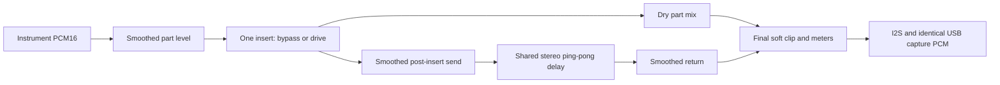

# First effects framework milestone

The subsequent [modular effects contract](custom-effects.md) moves algorithms out of the rack
and now provides compile-time serial slots, effect-owned controls and JSON v4. The record below describes the original implementation.

The rack now owns effects independently of concrete synth implementations:



There is one insert per compiled part and one shared delay send/return. Both
mixes retain `1/sqrt(compiled part capacity)` normalization before their dry
and wet outputs are combined. There are no arbitrary graph connections or
external feedback routes. Feedback stays inside the delay. Master insert FX,
multiple send buses, reverb, EQ, pan and tempo sync are future extensions.

## Parameters and control API

All values enter the existing Core1 parameter preparation and SPSC queue;
Core0 applies targets at block boundaries. Synths require no FX code and must
not claim framework-owned parameter IDs in their instrument profiles.

| Parameter enum | Range / default | Ownership |
| --- | --- | --- |
| PARAM_PART_LEVEL | 0..127 /127 | Each part, independent of per-channel MIDI gain |
| PARAM_FX_INSERT | INSERT_BYPASS or INSERT_DRIVE /bypass | Each part |
| PARAM_FX_DRIVE | 0..127 /0, maps to1x..8x drive | Each part |
| PARAM_FX_SEND | 0..127 /0 | Each part, post-level/post-insert send to BUS_DELAY |
| PARAM_DELAY_TIME_MS | 10..350ms /180ms | Shared BUS_DELAY |
| PARAM_DELAY_FEEDBACK | 0..90% /35% | Shared BUS_DELAY |
| PARAM_DELAY_RETURN | 0..127 /0 | Shared BUS_DELAY |

```cpp
using namespace SugarParts;
using namespace SugarParameters;
SugarEngine::setParameter(PART_1, PARAM_PART_LEVEL, 110);
SugarEngine::setParameter(PART_1, PARAM_FX_INSERT, SugarFX::INSERT_DRIVE);
SugarEngine::setParameter(PART_1, PARAM_FX_DRIVE, 40);
SugarEngine::setParameter(PART_1, PARAM_FX_SEND, 80);
SugarEngine::setBusParameter(SugarFX::BUS_DELAY, PARAM_DELAY_TIME_MS, 180);
SugarEngine::setBusParameter(SugarFX::BUS_DELAY, PARAM_DELAY_FEEDBACK, 45);
SugarEngine::setBusParameter(SugarFX::BUS_DELAY, PARAM_DELAY_RETURN, 80);
```

Check each setter's result, as with existing parameters. The bus API rejects
unsupported bus/parameter combinations. Requested/applied bus getters mirror
the part API, including leaving their output untouched on invalid requests.
Applied values represent accepted targets; smoothing/head crossfades may still
be finishing. Shared values currently use PART_1's control/preset storage, are
accessible through its generic parameter API, and appear on that part's
existing parameter page. They remain global even when PART_1 is inactive.
Other parts cannot own duplicate delay settings. The bus API keeps that storage
detail out of callers. No new MIDI CC assignment is introduced.

The existing engineering parameter page exposes these controls through registry
discovery. This milestone does not redesign navigation. New part Level adjusts
all of that part's channels together; existing Gain remains channel scoped.
Time edits use10ms steps. Default part levels are unity, inserts bypassed,
sends/return zero; the dry PCM path retains its prior output values.

## Smoothing, tails and bounds

Part level, insert wet/bypass crossfade, drive, sends, feedback and return use
128-frame linear ramps (~2.90ms at44100Hz). Retargeting starts from the current
coefficient. Inactive parts advance ramps without rendering their synths.
Drive uses the existing bounded quadratic soft shaper. Its drive0 setting
still shapes high peaks when enabled; use INSERT_BYPASS for the dry signal.

Delay time changes crossfade between two taps over128frames. New time targets
during that fade coalesce and begin after it completes, avoiding abrupt
read-head replacement. There is no pitch glide, interpolation or tempo sync.
Cross-feedback swaps left/right repeats. Equal left/right input remains centered;
one-sided input produces alternating echoes. No widening or pan is injected.
The integer coefficients use Q12 and signed constant-power-of-two division;
feedback rounds toward zero so negative one-sample residues eventually die.
The history write is soft-shaped before PCM16 storage; final output protection
remains after dry/wet summation. Deliberate drive coloration is separate from
that final protection. Correlated sends/returns can activate both shoulders.

Note release, part deactivation and reducing sends preserve the shared tail.
Insert bypass crossfades the insert only. Return0 mutes the wet output while
the delay/feedback continues internally. Reopening it can reveal a remaining
tail. Existing engine-wide panic, MIDI route reset, preset load and explicit
storage pause silence instruments and clear delay history. Individual MIDI
all-off events retain their existing part/channel behavior and let the shared
tail decay; there is no per-source tail ownership in a mixed shared bus.
These existing hard-reset boundaries can still produce discontinuities.

History invalidation is constant time: resetting the valid-frame count prevents
old cells from being read until overwritten. No64KiB memset runs in rendering.
One interleaved16384-frame PCM16 stereo ring uses65536bytes of internal DRAM;
maximum350ms corresponds to15435frames at44100Hz. Ramps, send scratch, part
scratch and sums also live in fixed internal RAM. There is no PSRAM, allocation,
filesystem, logging, lock or wait in FX processing and no new task/timer/ISR.
FX helpers are forced inline into the regular IRAM renderer/event entry points.
This avoids Xtensa's template/COMDAT literal-pool placement problem; the event
entry also disables jump tables. Coefficient preparation stays on Core1.
Existing scalar mix and event-consumer helpers are also forced inline so the
larger renderer does not move these operations into flash helper functions.

## Presets and verification

New saves use JSON version2. FX keys are `part_level`, `fx_insert`, `fx_drive`,
`fx_send`, `delay_time_ms`, `delay_feedback` and `delay_return` alongside the
existing supported parameters. Insert choices use stable strings `bypass` and
`drive`. Older version1 files load with unity levels and all effects bypassed;
their existing synth parameters and routes are preserved. Version2 requires all
supported keys. Unknown versions/keys/types, bad insert names and out-of-range
values are rejected. Old firmware cannot read version2 saves. Loading v1 does
not rewrite its file; explicitly saving writes v2. Delay sample history is
never serialized. Storage paths, backup recovery and muted handoff are retained.

Compiler-evaluated DSP checks cover ramp endpoint/retargeting, exact bypass,
post-insert sends, drive bounds, mute, impulse onset, stereo feedback, ring
wrap, stale-history invalidation, rapid time retargets, feedback limits and
signed tail termination. Startup codec checks include v2 round trips, strict
missing-FX rejection and v1 migration/defaults. These establish functional
properties, not audible quality or real-time headroom.

`./tools/build.ps1 -MixBoardChecks -BuildDirectory build-checks/mix-board-check`
adds the existing dry workloads followed by8s of drive plus shared delay and8s
of tail decay. It checks a nonzero wet return then zero return after decay,
validates bus API rejection, and restores the original preset. It writes no
files. The separate `-PresetBoardChecks` sequence exercises new FX settings
through spare flash/SD slots and cleans up its own files. Use diagnostics
separately; the normal build has no automatic notes or storage tests.

Manual checks: enable Drive on one part and compare bypass; raise Send and
DlyRet to hear delay; vary feedback/time while sustained notes play; drop Send
to hear the tail; save/change/load settings; compare I2S and USB recordings.
Exercise both engines and rapid control/MIDI traffic while watching
SugarAudio, SugarEngine, SugarFX and SugarUSB counters. SugarFX returnPeak is
the latest complete1024-block window, not an instantaneous silence indicator.

## Compliance check

| Category | Status | Evidence / limitation |
| --- | --- | --- |
| Target / Arduino IDE | PASS | ESP32-S3/core3.3.12; four builds pass without warnings; local64-frame setting preserved |
| Audio hot path | PASS | Bounded integer DSP/fixed arrays; FX/scalar/event helpers inline into regular IRAM entry points; no math-library, allocation, I/O, logging or blocking calls introduced |
| Core ownership / synchronization | PASS | Core1 prepares targets, Core0 owns FX state; existing SPSC/preset handoff and SharedWord meter publication |
| Memory / I/O | PASS | Fixed internal delay65536bytes plus bounded scratch/state; no PSRAM or renderer I/O; constant-time invalidation |
| Dependencies / includes | PASS | No new library or background mechanism; existing Arduino/ESP attributes/ArduinoJson only |
| Real-time validation | UNVERIFIED | Observed FX workload0.3082ms and preset diagnostic0.4350ms versus64-frame deadline1.4512ms; no overruns/faults; full sustained MIDI/control matrix and listening remain open |

## Build record (2026-10-23)

Arduino CLI warnings=all, no warnings. All DSP, parameter, profile, queue and
persistence compiler-evaluated assertions pass. These builds use the existing
local64-frame change, which remains outside the FX commit; the committed
configuration still defaults to128frames.

| Build | Flash bytes | Static RAM bytes |
| --- | ---: | ---: |
| Production, two parts | 699570 | 167640 |
| Production, one part | 687282 | 157704 |
| Mix/FX diagnostic | 702014 | 169768 |
| Flash/SD preset diagnostic | 702890 | 172008 |

Linked inspection places `SugarEngine::render` and `EngineTarget::onEvent` in
`.iram0.text`; fixed FX state is in `.dram0.data` (66248bytes including ring,
scratch and controls). FX, scalar soft-clip/normalization and event-pop/overflow
helpers have no separate flash function symbols. The existing queue-discard
helper can still be called from flash at preset/overflow reset boundaries.
Bounded block-zeroing can use
ESP ROM memset; delay-history invalidation never clears the large ring.
An initial Xtensa template literal-pool link error was fixed before these
builds by inlining helpers into non-template IRAM entry points.

## Board FX workload record (2026-10-23)

The final mix/FX diagnostic was uploaded with verified hashes over COM3 to the
S3 revision0.2. The capture began during the FX phase (uptime30s), so earlier
dry phases are covered only by the lifetime render maximum and completion flag.
Both inserts used Drive80; sends/return100, delay120ms and feedback70%.
At30/35s: wet return peak25799; master pre-clip peak72138, protected peak32767,
RMS -3.05..-3.03dBFS and83906..85404 soft-shaped samples per131072-sample window.
These are deliberately hot protection-test settings, with substantial saturation,
not factory sound defaults or a loudness target. The soft shoulder prevented
integer wraparound at the final PCM16 boundary.

After sends closed at35s, the40s report showed wet peak26; at43s the diagnostic
asserted wet peak0 and completed with requests PASS. Repeated later reports
showed `requestsAndFx=PASS stage=7`, silent master/wet output and original
settings restored. Lifetime maximum73967cycles at240MHz =0.3082ms, 21.24% of
the64/44100=1.4512ms render budget. overBudget/ioFault, eventQueueDrops,
parameterDifferences/presetRejected and control errors/rejections remained0.
USB capture remained active at176384..176435bytes/s without dropBlocks/fifoFull;
USB tasks reported Core1. Flash/SD were ready and codec checks PASS. The test
wrote no files. Normal UI resumed after completion (tickMaxUs713 by75s).

Evidence: ignored `build-checks/fx-workload-uart.log`. This is a short defined
workload, not full MIDI/CC burst, all-capacity, long-duration or listening
qualification. Physical controls, time-change artifacts, aliasing/distortion
quality and host recording/listening remain manual acceptance items.

## Flash/SD FX preset record (2026-10-23)

The final preset diagnostic also ran after a verified upload. UART at65..85s
repeatedly reported `flash=PASS sd=PASS stage=13`, meaning save, mutation of all
supported parameters (including FX), overwrite, load, original-state restoration,
SD missing/corrupt-main backup recovery, invalid/missing-file rejection and
owned-file cleanup completed. No formatting or pre-existing slot overwrite was
performed. Live codec checks (including generated v1 migration fixtures) PASS.
This does not claim a retained user v1 file was overwritten or migrated on disk.

Lifetime render maximum104410cycles (0.4350ms, 29.98% of the64-frame budget),
zero overruns/I/O faults/event drops/parameter differences/preset rejections;
flash/SD ready, storageMaxUs121003 across commands/devices. UI tickMaxUs750,
OLED0x3c with no errors/rejections; USB capture active at176384..176435bytes/s
with no dropBlocks/fifoFull. Master and wet output silent after restoration.
Storage still uses the explicit audio pause; these counters do not establish
gap-free audio during writes. Capture began after the storage sequence finished.
Evidence: ignored `build-checks/fx-presets-uart.log`.

Production firmware was restored with verified hashes. At80/85s it reported
idle master/wet peak0, renderMaxCycles46215 (0.1926ms), no overruns/I/O faults,
event drops, parameter differences or UI errors/rejections; tickMaxUs760.
Flash/SD ready, codec PASS, both parts active and USB capture active at176399B/s
without drops. No automatic diagnostic tags appeared. Defaults remain unity
part level, bypass inserts and zero sends/return. Evidence:
`build-checks/fx-normal-uart.log`. COM3 was closed/released afterwards.
