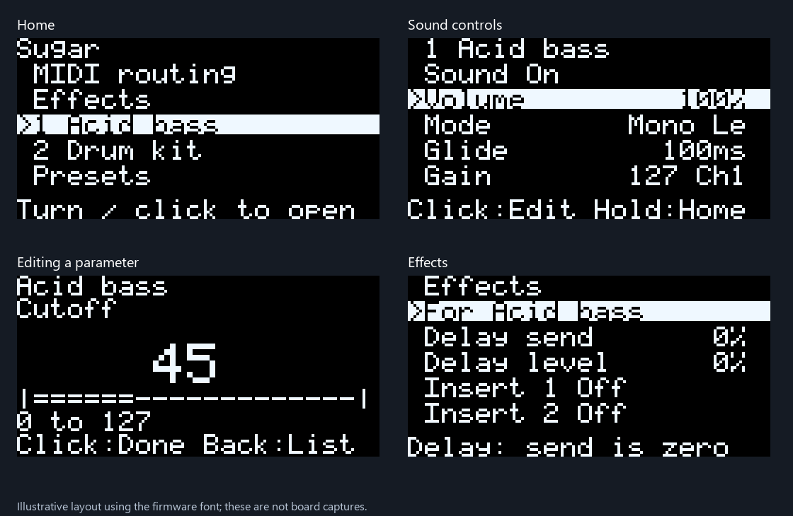

# Playing and editing from the OLED

Home lists MIDI Routing, Effects, the compiled instruments by name, and Presets.
Turn to choose a section and click to open it. Instruments keep their numbered
identity as well as their own name; custom names/parameters still come from
engine metadata. No menu item selects an engine implementation at runtime.

This illustration checks the intended pixel layout; it is not a board capture.
The display remains a 128x64 SH1106, using the same RDX pins and project font.
The font now has distinct lowercase letters, and UI labels use ordinary case
while preserving MIDI/SD acronyms. Lists use a 9-pixel baseline pitch with two
blank rows between seven-pixel glyphs: title/context, four controls and a separate
footer. Home shows up to five entries and scrolls; the focused editor retains its
large-value layout. A selected MIDI Back action appears in the footer so all
four possible destinations still fit. Preset status also uses the footer.

| Control | Action |
| --- | --- |
| Encoder turn | Select a row, or change the value when editing |
| Encoder click | Open a page, start/finish editing, or confirm the shown action |
| Encoder hold, 700ms | Return Home and cancel any unconfirmed preset action |
| GPIO41, Back | Close an editor/confirmation first; otherwise return Home |
| GPIO42, Next Page | Open the next section; on Home, select the next section |
| GPIO2, Next Field | Select the next control and leave edit mode |
| GPIO1, Play | Hold to audition the current sound; on MIDI, test the selected routes |

Back has the same meaning on every page. MIDI channel selection now uses the
CHANNEL row and encoder, rather than repurposing the Back/Next Page buttons.
Changing pages, routes, channels or FX target releases a held audition on its
original destination. Presets/Home do not start audition notes. During a preset
operation edits/navigation are gated and the footer says PLEASE WAIT.

## Sound controls

A page opens with its first editable row selected. The current row has a white
highlight extending one pixel above and below its text (clipped at screen edges); headings and informational group labels are skipped when browsing.
Clicking a parameter opens a focused editor with its full name (up to two lines),
value, and a numeric range bar. Short values use a doubled 10x14 pixel font;
long choice labels use the normal font so names such as Mono Legato remain
readable. Channel-scoped controls show their channel context.

Turning applies the value immediately. Click Done or press Back to return to
the list; Back does not undo live edits. Hold the encoder to return Home.
Requested/applied differences display an asterisk in lists or APPLYING in the
editor; queue rejections show a brief BUSY - TRY AGAIN message. Detailed counters
remain in serial logs. No new logging or work is added to the audio renderer.

Volume is shown as 0..100%. Instrument-owned controls retain their own units and
ranges. The four-row list uses aligned value columns; the focused editor exposes
labels/choices that do not fit the compact list. Labels longer than 42 characters
and choices longer than 21 characters still exceed this display's text capacity.

## Effects

FOR selects which sound's inserts/send you edit. Each Insert lists its selected
algorithm; Off means bypass. Its following controls come from the effect itself.
The shared effect is grouped under SHARED followed by its registered name.

Delay send controls how much of the selected sound enters the delay. Delay level
controls the shared return. Both start at 0%. A footer explains SEND IS ZERO or
LEVEL IS ZERO until both are nonzero. This is a routing hint, not an output-meter
measurement. To hear a clear test, set both around 80%, Time 300ms and Feedback 50%,
then play isolated notes. Insert slots may remain Off.

Framework Volume/Delay send/Delay level edits use percentage steps; stored values,
preset format and queued DSP gains remain 0..127. Each integer percent round-trips
through that representation. An arbitrary raw value from an older preset is
rounded for display and moves to the percent grid on the next edit. Instrument
parameters such as channel Gain continue using their own descriptors.

## Presets

Choose Internal or SD Card, then a slot. Save/Load opens a confirmation screen
showing the storage and slot; a second click performs the operation. Turn or
Back cancels before submission. Storage actions use plain labels: Reconnect SD
Card or Erase Internal Files. Erasing explicitly says ALL FILES ARE ERASED and
requires confirmation. It formats the entire internal data filesystem, not just
one slot. Existing coordinated audio pauses and storage behavior are unchanged.
JSON/version/filesystem implementation details stay out of the normal labels.

## Board acceptance

1. Check Home selection highlight, lowercase lettering/descenders, line spacing, engine names and all page links. Click a sound:
   its Sound ON row should be selected immediately, without selecting the title.
2. Open Cutoff or another numeric control: check its full name, doubled value,
   range bar, endpoints and units. Check a long choice such as Mono Legato and
   a channel-scoped control. Verify clockwise/counterclockwise edit behavior.
3. Check Back closes editing before leaving a page. Next Page must open the next
   section directly from sound, FX, MIDI and Presets. Hold encoder to return Home;
   its release must not reopen a page. Exercise Next Field while editing.
4. Edit Volume between 0/100%, then check Delay send/level. Verify silence hints
   clear when both are nonzero, shared return works for either target, and every
   configured insert/control remains reachable. Browse past shared headings.
5. On MIDI edit CHANNEL using the encoder. Check mute/layer/inactive indications,
   route toggles and audition; navigate away while holding Play and check release.
6. Open Save/Load and cancel by turn, Back and hold. Check storage/slot are clear.
   Confirm a spare-slot save/load. Do not confirm Erase unless deletion is intended.
7. Under intended maximum MIDI/FX/USB load, record renderMaxCycles, overBudget,
   ioFault, event/USB drops and UI tickMaxUs while using the editor for ten minutes.
   Test slow and quick turns, missing OLED behavior and any visible flicker.

Compiler checks cover all percent round-trips, signed-wide range math, doubled
font halves, exhaustive byte-page reconstruction of all seven-bit glyph patterns, and existing debounce/encoder/navigation behavior. The routing
board diagnostic now checks focused FX selection, Back semantics, direct Next
Page navigation with audition release, percentage volume edits, routing and
preset restoration. Compilation does not establish these physical/runtime results.

## Compliance check

| Category | Status | Evidence / limitation |
| --- | --- | --- |
| Target / Arduino IDE | PASS | Existing ESP32-S3/core3.3.12 sketch, SH1106 and pins; builds recorded in validation.md |
| Audio hot path | PASS | Only UI/control and diagnostic files changed; no new DSP or audio-task operations |
| Core ownership / synchronization | PASS | Existing Core1 loop/sole event producer; engine APIs and publication unchanged |
| Memory / I/O | PASS | Existing fixed 8x22 text frame and entry buffer; bounded temporary editor strings; same 16-column transactions/100ms frame cadence; at most two body glyph fragments plus the footer fragment per column; no new runtime allocations |
| Dependencies / includes | PASS | No new firmware library, task, timer, ISR or include dependency; illustrative image generated offline |
| Real-time validation | UNVERIFIED | Pixel scaling adds bounded Core1 work; physical appearance, input latency and maximum-workload timing need board measurement |
